# Found Footy

Found Footy discovers and curates football-event videos in near real time. It
polls API-Football for live fixtures, tracks goals, red cards, and missed
penalties, and starts a 15-attempt X discovery workflow for each confirmed
event. Candidate clips pass media filters, vision validation, perceptual
deduplication, and ranking before the surviving assets reach
[vedanta.systems](https://vedanta.systems).

Production has run the Go rebuild since the 2026-08-15 cutover. The retired
[Python implementation is preserved in Git](./docs/decisions/2026-10-21-retire-python-working-tree.md)
as historical reference, not a supported production rollback.

## Pipeline

```mermaid
flowchart LR
    API[API-Football] --> INGEST[Temporal ingest and monitor]
    INGEST --> EVENT[EventWorkflow]
    EVENT --> SEARCH[Per-event Firefox X search]
    SEARCH --> MEDIA[Download and media filters]
    MEDIA --> HASH[Dense perceptual hashing]
    HASH --> VISION[Gemma 4 vision validation]
    VISION --> DEDUP[Perceptual deduplication and ranking]
    DEDUP --> STORE[PostgreSQL and Garage]
    STORE --> FEED[NATS and Chi read API]
    FEED --> UI[vedanta.systems]
```



Perceptual deduplication is intentionally scoped by event and validation
category. See the [orchestration ledger](./docs/orchestration/) for the
shipped workflow contracts.

## Stack

- Go 1.25 and the Temporal Go SDK
- PostgreSQL for fixtures, events, candidates, assets, and workflow state
- Garage for S3-compatible object storage
- A Go/Playwright service with one Firefox instance per active event
- Gemma 4 12B through a remote llama.cpp-compatible vision endpoint
- NATS for feed events and a Chi HTTP API for reads
- Docker Compose and Caddy on the shared proxy network

## Development

The toolchain runs in Docker; no host Go installation is required.

Before `make dev-up` on a fresh host, follow the
[deployment prerequisites](./docs/deployment.md#compose-files) and
[first-time dev bootstrap](./docs/deployment.md#first-time-dev-bootstrap) for
shared networks, cookie-directory permissions, and Garage provisioning.

```bash
cp .env.example .env
$EDITOR .env
make hooks
make dev-up
```

Firefox lifecycle ownership is scoped by the Compose-selected environment
network, so dev and production can share one Docker daemon without counting or
reaping each other's browsers. Production is live and every production mutation
still requires explicit per-action approval. Use the
[deployment ledger](./docs/deployment.md) instead of inferring production
commands from this README.

Useful local checks:

```bash
make check-short
make check
make test-short
make test
make test-race
make test-corpus
```

## Repository layout

| Path | Purpose |
|---|---|
| [`cmd/`](./cmd/), [`internal/`](./internal/) | Application entry points, domain logic, workflows, and adapters. |
| [`test/`](./test/) | Cross-package contracts and fixture-lifecycle scenarios; package unit tests live beside their Go code. |
| [`migrations/`](./migrations/) | Immutable, ordered PostgreSQL migrations. |
| [`operator-ui/`](./operator-ui/) | Independent, read-only video-review tool with its own Go module. |
| [`scripts/`](./scripts/) | Build, deployment, recovery, and opt-in research tools. |
| [`docker/`](./docker/), [`caddy/`](./caddy/), `Dockerfile*`, `docker-compose.*.yml`, [`garage.toml`](./garage.toml) | Container builds, routing, and service declarations. |
| [`go.mod`](./go.mod), [`go.sum`](./go.sum) | Go dependency requirements and integrity checksums; both belong in Git. |
| [`Makefile`](./Makefile), [`.githooks/`](./.githooks/), [`.golangci.yml`](./.golangci.yml) | Versioned build, test, commit, push, and lint gates. Install hooks with `make hooks`. |
| [`.editorconfig`](./.editorconfig), [`.air.toml`](./.air.toml) | Editor-neutral formatting and worker/API development hot reload. Personal editor settings are ignored. |
| [`.env.example`](./.env.example), [`.gitignore`](./.gitignore), [`.dockerignore`](./.dockerignore) | Configuration template and exclusions for secrets, local state, and build inputs. |
| [`AGENTS.md`](./AGENTS.md), [`CLAUDE.md`](./CLAUDE.md) | Agent instructions; `CLAUDE.md` is a compatibility symlink to the same file, not contributor metadata. |

`main` is the canonical Go branch. Production uses immutable commit-tagged
images; committing or pushing repository cleanup does not deploy it.

## Documentation

- [`docs/README.md`](./docs/README.md) — routing index and authority map
- [`docs/todo.md`](./docs/todo.md) — canonical bugs and deferred work
- [`docs/architecture.md`](./docs/architecture.md) — as-built package and adapter ledger
- [`docs/orchestration/`](./docs/orchestration/) — workflow and activity contracts
- [`docs/deployment.md`](./docs/deployment.md) — Compose, routing, and bootstrap
- [`docs/operations.md`](./docs/operations.md) — current safety boundary and runbook status
- [`docs/decisions/README.md`](./docs/decisions/) — architectural decision index
- [`docs/design/README.md`](./docs/design/README.md) — design history and audit evidence

Agents working in this repository must read [`AGENTS.md`](./AGENTS.md) first.

## License

Project source is licensed under the [MIT License](./LICENSE). Third-party
reference materials retain their own terms. This license does not grant rights
to discovered football footage.
